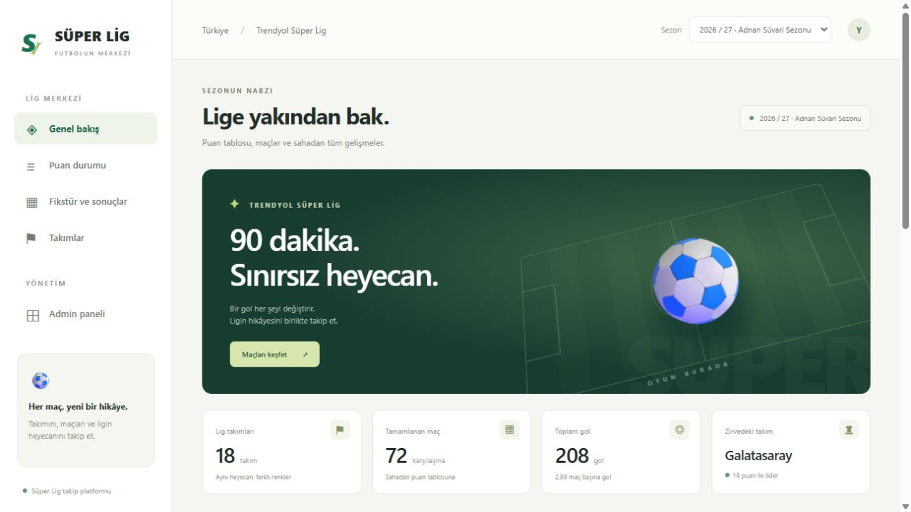
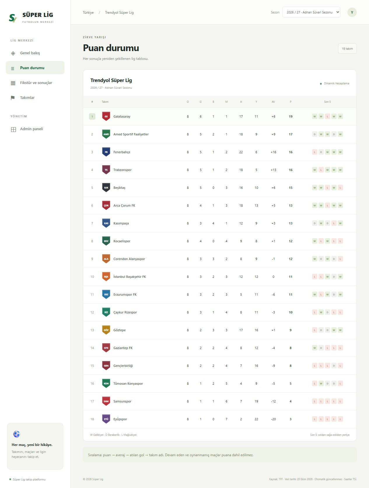
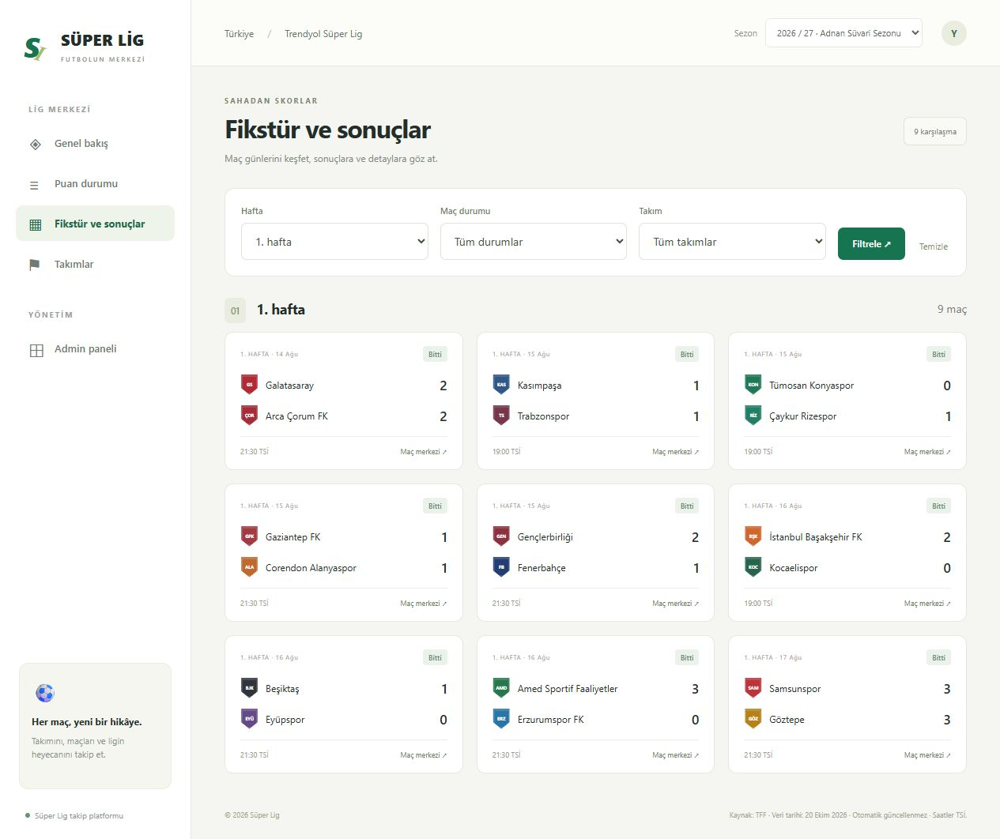
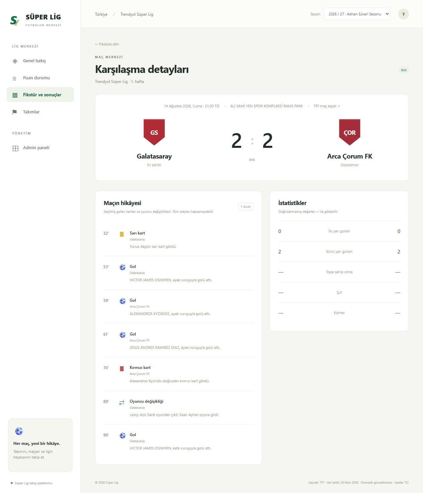
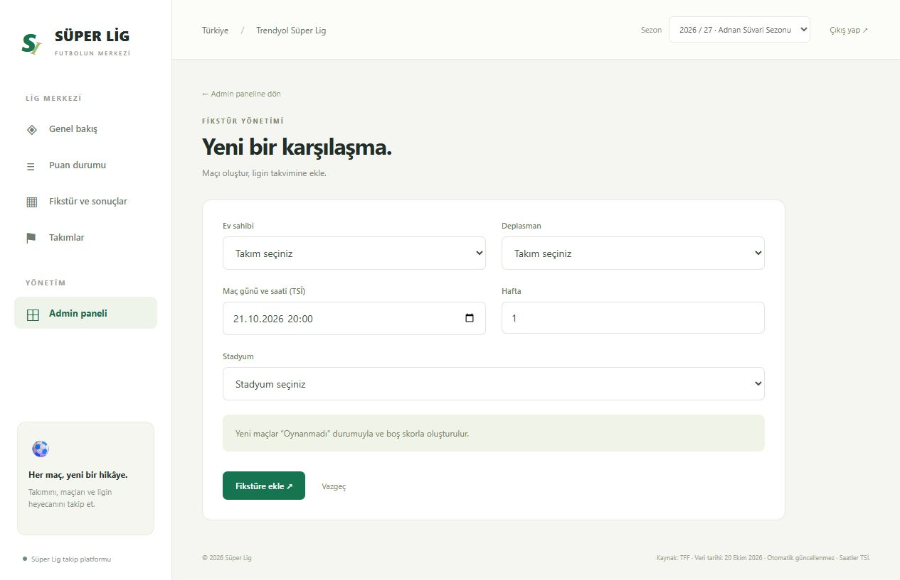
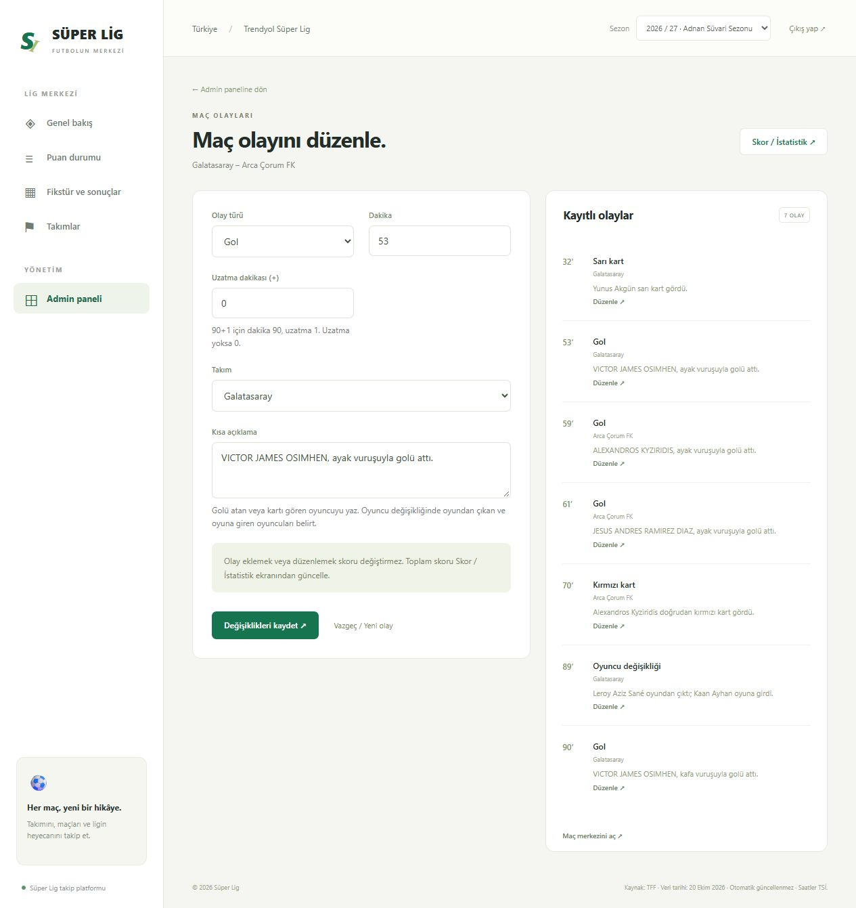

# Trendyol Süper Lig — League

Takımları, fikstürü, maç sonuçlarını ve puan durumunu tek yerde sunan bir ASP.NET Core MVC uygulaması. Admin panelinden fikstür, skor, istatistik ve maç olayları yönetilebilir.

## Özellikler

- Sezon özeti, yaklaşan maçlar ve lider takım bilgisi.
- Maç sonuçlarından hesaplanan puan tablosu, averaj ve son beş maç formu.
- Hafta, takım ve maç durumuna göre fikstür filtreleme.
- Maç detayında skor, yarı istatistikleri ve olay akışı.
- Admin panelinden maç oluşturma ve sonuç güncelleme.
- Gol, sarı kart, kırmızı kart ve oyuncu değişikliği ekleme ve düzenleme.
- Türkçe ve mobil uyumlu arayüz.

## Teknolojiler

ASP.NET Core MVC · .NET 10 · Entity Framework Core · SQL Server · Razor · HTML / CSS / JavaScript

Proje, N-Layer mimarisiyle dört katmandan oluşur:

| Katman | Sorumluluk |
|---|---|
| EntityLayer | Veri modelleri ve enum tanımları |
| DataAccessLayer | Veritabanı bağlantısı, ilişkiler ve veri erişimi |
| BusinessLayer | İş kuralları, servisler, DTO'lar ve puan hesabı |
| WebUI | Kullanıcı arayüzü, controller'lar ve admin paneli |

## Ekran Görüntüleri

### Puan durumu

Takımların puanları, gol istatistikleri ve son beş maç sonuçları.

### Fikstür ve sonuçlar

Hafta, takım ve durum filtreleriyle maç takibi.

### Maç detayı

Skor, goller, kartlar, oyuncu değişiklikleri ve yarı istatistikleri.

### Fikstür ekleme

Ev sahibi, deplasman, tarih, hafta ve stadyum seçimiyle yeni karşılaşma oluşturma.

### Maç olaylarını düzenleme

Kayıtlı olayın türünü, takımını, dakikasını ve açıklamasını güncelleme.

## Yerel admin girişi

| Kullanıcı adı | Şifre |
|---|---|
| `admin` | `LeagueDemo!2026` |

Bu hesap Development ortamı içindir. Diğer ortamlarda yönetici bilgileri `Admin__Username` ve `Admin__Password` ortam değişkenleriyle tanımlanır.

## Veriler

Başlangıç verileri, [TFF'nin](https://www.tff.org/Default.aspx?pageID=198) **20 Ekim 2026** tarihli 2026/27 sezonu kayıtlarına dayanır: 18 takım, 306 karşılaşma, 72 bitmiş sonuç ve dört maç için toplam 18 seçilmiş olay. Veriler otomatik yenilenmez; yeni sonuçlar admin panelinden girilebilir. Kaynakta bulunmayan istatistikler boş gösterilir.

Puan durumu ayrı bir tabloda tutulmaz; bitmiş maçlardan galibiyet **3**, beraberlik **1**, mağlubiyet **0** puan kuralıyla hesaplanır. Maç olayları ve istatistikler `MatchId` üzerinden ilgili karşılaşmaya bağlıdır.
